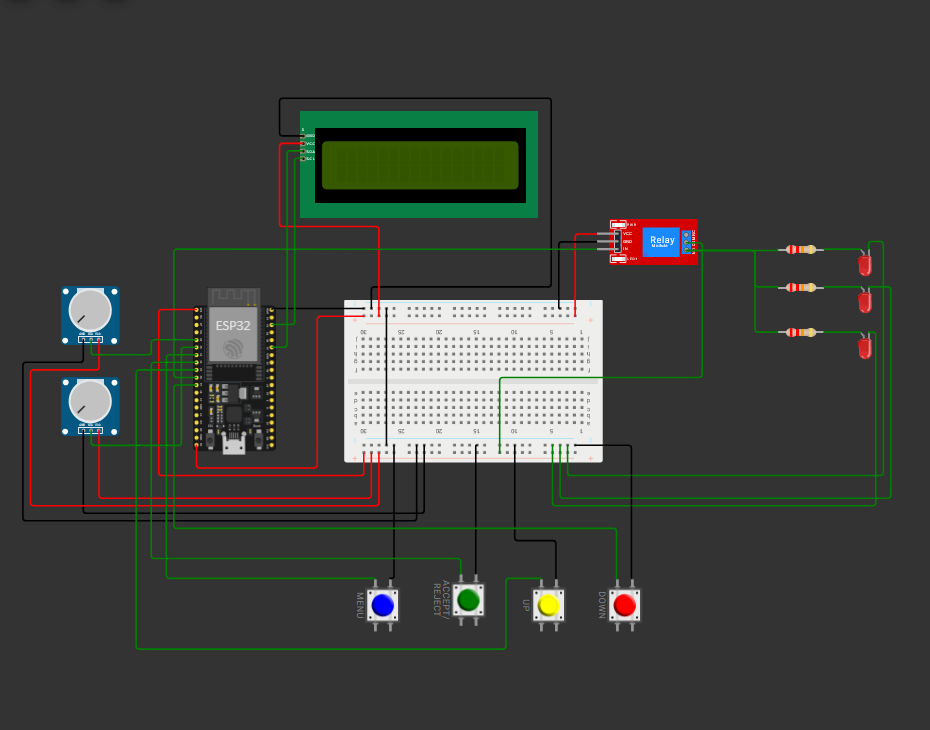

# ESP32 Voltage & Over-Current Protector

## How to run (Wokwi)

Click this link : **[https://wokwi.com/projects/477393031120734209](https://wokwi.com/projects/477393031120734209)** and simulate by pressing the play button !

## User manual

### 1.1 Meet the controls

| Control | Where | Use |
| --- | --- | --- |
| **P1** pot | Left | Simulates supply voltage (POT mode) |
| **P2** pot | Left | Simulates load current |
| **SET** button | GPIO32 | Open the settings menu / skip a setting |
| **ACCEPT / REJECT** button | GPIO33 | 1 click = accept, 2 clicks = reject |
| **+** button | GPIO25 | Increase a value |
| **-** button | GPIO27 | Decrease a value |
| **3 LEDs** | Right | The appliances. On = powered, off = disconnected |
| **LCD** | Top | Live readings and menus |

Pot guide:

| Pot position | Voltage (P1) | Current (P2) |
| --- | --- | --- |
| 25% | 75 V | 5 A |
| 50% | 150 V | 10 A |
| 60% | 180 V | 12 A |
| 77% | 230 V | 15 A |
| 83% | 250 V | 17 A |
| 100% | 300 V | 20 A |

### 1.2 The main screen
